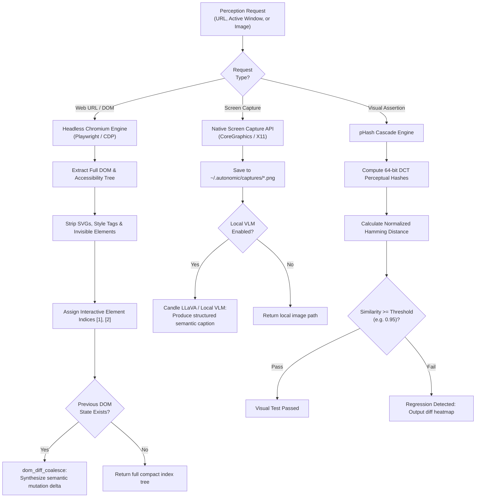

# agent-eyes — Deep Operational & Architectural Context for Agents

> **Observability, DOM Indexing & Perceptual Visual QA** — In-depth architectural guide, accessibility tree extraction, pHash visual regressions, CLI matrix, HTTP/MCP contracts, and failure recovery runbooks for `agent-eyes`.  
> **Ecosystem Version Baseline:** `v1.0.0-beta.3`  
> **Documentation Hub:** [https://autonomic-ai.dev/docs/perception](https://autonomic-ai.dev/docs/perception) · [Architecture Hub](https://autonomic-ai.dev/docs/architecture)  
> **Port:** HTTP API `:3105`  
> **Default Workspace & Captures:** `~/.autonomic/eyes/` · `~/.autonomic/captures/`

---

## 1. Executive Summary & Biological Role

In the Autonomic 11-organ architecture, **`agent-eyes`** serves as the **Perceptual Observability Engine, DOM Indexer, and Visual State Validator** (analogous to OpenTelemetry Visual Tracing, Prometheus for UI state, and headless perceptual assertions).

When AI agents interact with web applications, frontends, or desktop user interfaces, standard multimodal LLM workflows encounter severe inefficiencies:
1. **Raw Screenshot Context Flooding:** Sending high-resolution PNGs (1000x1000+) on every turn consumes 1,500+ tokens per image, costs substantial API fees, and introduces 2–5 second network latencies.
2. **Raw HTML Bloat:** Pumping raw DOMs with thousands of CSS utility classes, SVG paths, and script tags exhausts model context windows with irrelevant noise.
3. **Flaky Pixel Diffs:** Naive pixel-by-pixel comparisons fail on minor font antialiasing or clock rendering differences.

`agent-eyes` solves these issues through intelligent perceptual compression:
- **Token-Efficient DOM Indexing:** Strips presentation bloat and extracts a dense, accessibility-focused tree with numeric index tags (`[1] Button: 'Submit'`).
- **Semantic Delta Coalescing:** Emits only the elements that mutated since the prior turn, reducing browsing context by up to 90%.
- **Sub-Millisecond Perceptual Hashing (pHash):** Evaluates visual layout similarity locally using multi-scale perceptual hashing, catching visual regressions without requiring expensive multimodal LLM calls.

---

## 2. Core Architecture & Perception Pipeline



### 2.1 Compact Accessibility DOM Indexing
`agent-eyes` parses web interfaces using Chrome DevTools Protocol (CDP):
- Filters out non-interactive layout containers, hidden elements (`display: none`, `visibility: hidden`, `aria-hidden="true"`), and base64 assets.
- Maps interactive components (buttons, links, inputs, selects) into an indexed hierarchy:
  ```text
  [1] <input type="email" placeholder="Email" value="">
  [2] <input type="password" placeholder="Password">
  [3] <button type="submit"> "Log In"
  [4] <a href="/forgot"> "Forgot password?"
  ```
- Agents can interact using exact element indices (`click [3]`, `type [1] "admin@example.com"`).

### 2.2 Perceptual Hashing (pHash) Visual Regression
Rather than uploading gigabytes of screenshots to remote vision models:
- Computes Discrete Cosine Transform (DCT) perceptual hashes of baseline and candidate screenshots.
- Compares normalized Hamming distances in `< 5ms`.
- Absorbs sub-pixel antialiasing differences while detecting missing elements, broken layouts, or color inversions.

---

## 3. Complete CLI Command Reference & Flags

`agent-eyes` provides a single native binary for daemon service, screen capture, DOM extraction, and visual regression testing:

### 3.1 DOM Indexing Commands
- `agent-eyes dom`: Extract token-efficient accessibility tree from a web page.
  - `--url <URL>`: Target website or local development server address.
  - `--interactive-only`: Restrict output strictly to clickable and input elements.
  - `--json`: Output elements in structured JSON with bounding boxes and role attributes.

### 3.2 Visual Capture & pHash Diffing
- `agent-eyes capture`: Take screenshot of active display or web URL.
  - `--url <URL>`: Render URL in headless browser before capture.
  - `--out <FILE.png>`: Output image filepath (default: `~/.autonomic/captures/capture_<timestamp>.png`).
  - `--viewport <WIDTHxHEIGHT>`: Custom browser resolution (default: `1280x800`).
- `agent-eyes diff <BASELINE.png> <CURRENT.png>`: Compare two screenshots using perceptual hashing.
  - `--threshold <FLOAT>`: Similarity cutoff between 0.0 and 1.0 (default: `0.95`).
  - `--json`: Output similarity score, Hamming distance, and pass/fail verdict.

### 3.3 Daemon & HTTP Service
- `agent-eyes serve`: Start the HTTP REST API server and NATS JetStream listener.
  - `--port <PORT>`: HTTP listening port (default: `3105`).
  - `--screenshot-dir <DIR>`: Custom storage location for captures.
  - `--nats-url <URL>`: NATS broker URL.

### 3.4 Diagnostics & Health Audit
- `agent-eyes doctor`: Verify Chromium / Playwright driver readiness, check screen capture permissions on macOS, and test local VLM weights if configured.

---

## 4. HTTP & Model Context Protocol (MCP) Contracts

### 4.1 HTTP REST Endpoints (`:3105`)

#### `POST /dom/index`
Extract compact indexed DOM tree.
Request:
```json
{
  "url": "http://localhost:3000/login",
  "interactive_only": true
}
```
Response (`200 OK`):
```json
{
  "elements_count": 4,
  "indexed_tree": "[1] <input name=\"email\">\n[2] <input type=\"password\">\n[3] <button> \"Sign In\"\n[4] <a href=\"/reset\"> \"Help\"",
  "tokens_estimate": 42
}
```

#### `POST /diff`
Perform perceptual visual assertion.
Request:
```json
{
  "baseline_path": "/workspace/baseline.png",
  "current_path": "/workspace/test_run.png",
  "threshold": 0.95
}
```
Response (`200 OK`):
```json
{
  "passed": true,
  "similarity": 0.984,
  "hamming_distance": 1
}
```

#### `GET /health`
Returns perception daemon status and browser driver availability.

---

### 4.2 MCP Tools (via `agent-body serve-mcp` or stdio)

#### `eyes_describe_dom`
- **Description:** Returns an indexed, token-compact accessibility tree of a web application to enable precise agent interaction.
- **Parameters:**
  - `url` (string, required): Web page URL to index.
  - `interactive_only` (boolean, optional, default `true`): Include only clickable/input nodes.

#### `eyes_diff_screenshots`
- **Description:** Computes perceptual similarity between two images to assert that a UI modification did not introduce visual regressions.
- **Parameters:**
  - `baseline_image_path` (string, required): Path to approved baseline image.
  - `candidate_image_path` (string, required): Path to newly captured test image.
  - `similarity_threshold` (float, optional, default `0.95`): Minimum score to pass.

#### `eyes_vlm_caption`
- **Description:** Generates a structured semantic description of key UI components from an image using local or remote VLM inference.
- **Parameters:**
  - `image_path` (string, required): Image path to inspect.

---

## 5. Troubleshooting & Recovery Runbook

### 5.1 Problem: Chromium / Playwright Driver Not Found
- **Symptom:** `agent-eyes dom` errors with "Browser driver missing".
- **Resolution:**
  - Install browser binaries:
    ```bash
    npx playwright install chromium
    ```
  - Verify setup: `agent-eyes doctor`.

### 5.2 Problem: Screen Capture Denied on macOS
- **Symptom:** Screenshot returns solid black or permission error.
- **Resolution:**
  - Open macOS **System Settings** → **Privacy & Security** → **Screen Recording**.
  - Grant permission to terminal or `agent-eyes` binary.
